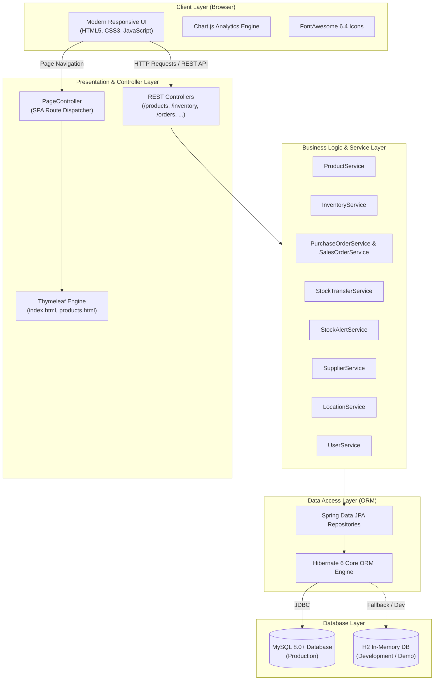
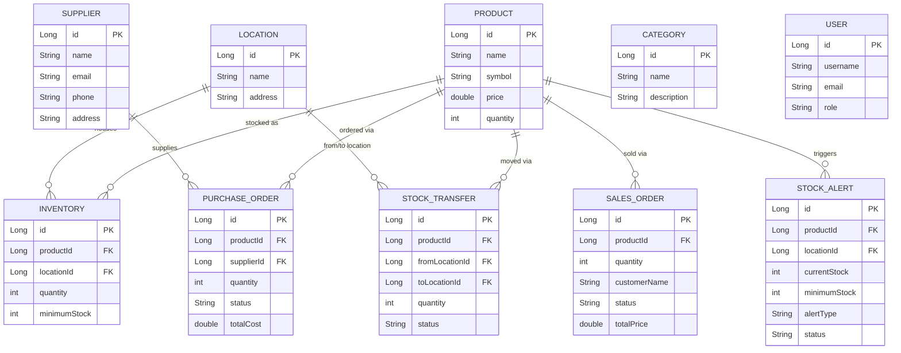

# 📦 StockSmart — Enterprise Inventory & Stock Management System

[](https://openjdk.org/)
[](https://spring.io/projects/spring-boot)
[](https://spring.io/projects/spring-data-jpa)
[](https://hibernate.org/)
[](https://www.mysql.com/)
[](https://www.thymeleaf.org/)
[](LICENSE)

---

## 📌 Executive Summary

**StockSmart** is an enterprise-grade, full-stack inventory, supply chain, and warehouse operations management platform built with **Java 21**, **Spring Boot**, **Spring Data JPA / Hibernate**, and a modern, responsive web dashboard. 

Managing stock effectively is critical for minimizing capital lockup, preventing inventory stockouts, streamlining multi-warehouse transfers, and accelerating purchase and sales cycles. **StockSmart** provides an end-to-end digital ecosystem that unifies product cataloging, multi-facility inventory monitoring, automated stock replenishment alerts, supplier coordination, and order lifecycles into a cohesive single-pane interface.

---

## 🌟 Key Features

### 1. 📊 Executive Analytics & KPI Dashboard
- **Real-Time KPIs**: Instant metrics for Total Inventory Valuation, Critical Low-Stock Alerts, Active Purchase Orders, and In-Transit Transfers.
- **Visual Analytics**: Interactive data visualization powered by [Chart.js](https://www.chartjs.org/) for stock distribution by category and order volume trends.
- **Global Search**: High-performance real-time search across product catalog, warehouses, suppliers, and orders.
- **Theme Customization**: Built-in Dark and Light mode toggle for optimal operational usability.

### 2. 🏷️ Product Catalog & Categorization
- **Catalog Master**: Register products with unique SKU/symbol identifiers, unit retail pricing, and base quantities.
- **Category Hierarchy**: Organize items into structured departments (e.g., Electronics, Hardware, Apparel, Perishables) for structured filtering.
- **Full CRUD Support**: Add, update, view, and retire products with instantaneous UI reflection.

### 3. 🏢 Multi-Warehouse & Location Tracking
- **Multi-Facility Management**: Model physical distribution centers, regional warehouses, and retail staging sites.
- **Location-Specific Stock Matrix**: Break down product inventory by exact location ID.
- **Minimum Stock Safeguards**: Define location-level threshold triggers to avert stockouts before they disrupt operations.

### 4. 🚚 Supplier Relationship Management (SRM)
- Maintain an authenticated vendor directory with contact points, emails, phone numbers, and physical fulfillment addresses.
- Correlate purchase orders directly against certified vendors.

### 5. 📥 Purchase & 📤 Sales Order Workflows
- **Purchase Orders (Inbound)**: Generate replenishment orders to suppliers with status pipelines (`PENDING`, `APPROVED`, `RECEIVED`).
- **Sales Orders (Outbound)**: Log customer shipments, track delivery statuses, and monitor outgoing inventory deductions.

### 6. 🔄 Multi-Location Stock Transfers
- Transfer physical stock between warehouse locations with full audit trails.
- Track transfer statuses (`IN_TRANSIT`, `COMPLETED`, `CANCELLED`) to ensure inventory integrity.

### 7. ⚠️ Automated Stock Alerts
- Automated low-stock detection comparing real-time quantities against minimum safety thresholds.
- Alert classifications (`CRITICAL`, `WARNING`, `REORDER`) with visual badges in the sidebar.

### 8. 👥 User & Access Directory
- User account roster tracking team members, operational roles, and credentials.

### 9. ⚡ One-Click Demo Data Generator
- Built-in simulation tool to seed realistic catalog items, suppliers, warehouses, and orders for rapid demonstration and testing.

---

## 🏗️ Architecture & Technology Stack

### System Architecture Diagram



### Technology Matrix

| Layer | Technology | Version | Purpose |
| :--- | :--- | :--- | :--- |
| **Language** | Java (OpenJDK) | 21 (or 17+) | Core enterprise programming language |
| **Framework** | Spring Boot | 4.1.1 | Application bootstrapping & REST web service framework |
| **Persistence** | Spring Data JPA / Hibernate | Latest | Object-Relational Mapping (ORM) and repository abstraction |
| **Primary Database** | MySQL Connector/J | 8.0+ | Production persistent relational data store |
| **Embedded DB** | H2 Database | Latest | Out-of-the-box local testing & rapid prototyping |
| **Template Engine** | Thymeleaf | 3.x | Dynamic server-side UI rendering |
| **Frontend Styling** | Custom CSS3 + Flexbox/Grid | Native | Dark/Light themed responsive layout |
| **Visualizations** | Chart.js | 4.x CDN | Dynamic charts & metrics visualization |
| **Icons** | FontAwesome | 6.4.0 CDN | Scalable vector interface icons |
| **Build Tool** | Apache Maven & Maven Wrapper | 3.9+ | Dependency management and build packaging |

---

## 🗄️ Entity-Relationship (ER) Model



---

## 🔌 REST API Specification

All endpoints communicate via JSON and support standard HTTP verbs:

| Resource | HTTP Method | Endpoint | Description |
| :--- | :---: | :--- | :--- |
| **Products** | `GET` | `/products` | List all catalog products |
| | `GET` | `/products/{id}` | Retrieve specific product by ID |
| | `POST` | `/products` | Register a new product |
| | `PUT` | `/products/{id}` | Update existing product details |
| | `DELETE` | `/products/{id}` | Remove product from catalog |
| **Categories** | `GET` | `/categories` | List all product categories |
| | `POST` | `/categories` | Create a new category |
| | `PUT` | `/categories/{id}` | Update category details |
| | `DELETE` | `/categories/{id}` | Delete category |
| **Inventory** | `GET` | `/inventory` | View stock distribution across warehouses |
| | `POST` | `/inventory` | Create a new inventory record |
| | `PUT` | `/inventory/{id}` | Update inventory quantities & thresholds |
| | `DELETE` | `/inventory/{id}` | Remove inventory entry |
| **Locations** | `GET` | `/locations` | List warehouse locations |
| | `POST` | `/locations` | Register a new warehouse facility |
| | `PUT` | `/locations/{id}` | Update warehouse location |
| | `DELETE` | `/locations/{id}` | Delete warehouse location |
| **Suppliers** | `GET` | `/suppliers` | List all suppliers |
| | `POST` | `/suppliers` | Onboard a new supplier |
| | `PUT` | `/suppliers/{id}` | Update supplier profile |
| | `DELETE` | `/suppliers/{id}` | Delete supplier |
| **Purchase Orders** | `GET` | `/purchase-orders` | List all purchase orders |
| | `POST` | `/purchase-orders` | Issue a purchase order |
| | `PUT` | `/purchase-orders/{id}`| Update PO status / quantities |
| | `DELETE` | `/purchase-orders/{id}`| Delete purchase order |
| **Sales Orders** | `GET` | `/sales-orders` | List all customer sales orders |
| | `POST` | `/sales-orders` | Register new sales order |
| | `PUT` | `/sales-orders/{id}` | Update sales order status |
| | `DELETE` | `/sales-orders/{id}` | Delete sales order |
| **Stock Transfers** | `GET` | `/stock-transfers` | List inventory transfer records |
| | `POST` | `/stock-transfers` | Initiate stock transfer |
| | `PUT` | `/stock-transfers/{id}`| Update transfer status |
| | `DELETE` | `/stock-transfers/{id}`| Delete transfer record |
| **Stock Alerts** | `GET` | `/stock-alerts` | View low stock alerts |
| | `POST` | `/stock-alerts` | Log manual stock alert |
| | `PUT` | `/stock-alerts/{id}` | Update alert status |
| | `DELETE` | `/stock-alerts/{id}` | Dismiss stock alert |
| **Users** | `GET` | `/users` | List system users |
| | `POST` | `/users` | Register a new user account |
| | `DELETE` | `/users/{id}` | Remove user account |

---

## 📂 Project Structure

```text
StockSmart/
├── .mvn/
│   └── wrapper/
│       └── maven-wrapper.properties
├── src/
│   ├── main/
│   │   ├── java/
│   │   │   └── com/HCL/Stock/
│   │   │       ├── controller/        # REST & MVC Endpoints
│   │   │       │   ├── CategoryController.java
│   │   │       │   ├── InventoryController.java
│   │   │       │   ├── LocationController.java
│   │   │       │   ├── PageController.java
│   │   │       │   ├── ProductController.java
│   │   │       │   ├── PurchaseOrderController.java
│   │   │       │   ├── SalesOrderController.java
│   │   │       │   ├── StockAlertController.java
│   │   │       │   ├── StockTransferController.java
│   │   │       │   ├── SupplierController.java
│   │   │       │   └── UserController.java
│   │   │       ├── entity/            # JPA Hibernate Data Entities
│   │   │       │   ├── Category.java
│   │   │       │   ├── Inventory.java
│   │   │       │   ├── Location.java
│   │   │       │   ├── Product.java
│   │   │       │   ├── PurchaseOrder.java
│   │   │       │   ├── SalesOrder.java
│   │   │       │   ├── StockAlert.java
│   │   │       │   ├── StockTransfer.java
│   │   │       │   ├── Supplier.java
│   │   │       │   └── User.java
│   │   │       ├── repository/        # Spring Data JPA Repositories
│   │   │       │   ├── CategoryRepository.java
│   │   │       │   ├── InventoryRepository.java
│   │   │       │   ├── LocationRepository.java
│   │   │       │   ├── ProductRepository.java
│   │   │       │   ├── PurchaseOrderRepository.java
│   │   │       │   ├── SalesOrderRepository.java
│   │   │       │   ├── StockAlertRepository.java
│   │   │       │   ├── StockTransferRepository.java
│   │   │       │   ├── SupplierRepository.java
│   │   │       │   └── UserRepository.java
│   │   │       ├── service/           # Business Logic Layer
│   │   │       │   ├── CategoryService.java
│   │   │       │   ├── InventoryService.java
│   │   │       │   ├── LocationService.java
│   │   │       │   ├── ProductService.java
│   │   │       │   ├── PurchaseOrderService.java
│   │   │       │   ├── SalesOrderService.java
│   │   │       │   ├── StockAlertService.java
│   │   │       │   ├── StockTransferService.java
│   │   │       │   ├── SupplierService.java
│   │   │       │   └── UserService.java
│   │   │       └── StockApplication.java   # Spring Boot Main Entry Point
│   │   └── resources/
│   │       ├── static/
│   │       │   ├── css/
│   │       │   │   └── style.css      # Enterprise CSS Theme & Responsive Styling
│   │       │   └── js/
│   │       │       ├── app.js         # Core Single Page App JavaScript Logic
│   │       │       ├── product.js     # Product-specific scripts
│   │       │       └── script.js      # Utility scripts
│   │       ├── templates/
│   │       │   ├── index.html         # Main Application Dashboard
│   │       │   └── products.html      # Product Catalog View
│   │       └── application.properties # App & Database Config
│   └── test/
│       └── java/
│           └── com/HCL/Stock/
│               └── StockApplicationTests.java
├── .gitattributes
├── .gitignore
├── mvnw
├── mvnw.cmd
├── pom.xml
└── README.md
```

---

## 🚀 Getting Started

### Prerequisites

- **Java JDK**: Version 21 (or 17+) installed. Verify with:
  ```bash
  java -version
  ```
- **Maven**: Version 3.8+ (optional; the repository includes `./mvnw` wrapper).
- **MySQL Server** *(Optional)*: Running on port `3306` if using MySQL persistence.

### Configuration (`application.properties`)

The application runs on port `8083` by default.

#### Option A: MySQL (Default)
Ensure your MySQL server is running, and configure your credentials in `src/main/resources/application.properties`:
```properties
server.port=8083

spring.datasource.url=jdbc:mysql://localhost:3306/stock?createDatabaseIfNotExist=true&useSSL=false&allowPublicKeyRetrieval=true&serverTimezone=UTC
spring.datasource.username=root
spring.datasource.password=YOUR_MYSQL_PASSWORD
spring.datasource.driver-class-name=com.mysql.cj.jdbc.Driver

spring.jpa.hibernate.ddl-auto=update
spring.jpa.show-sql=true
```

#### Option B: H2 In-Memory (Zero Configuration)
If you prefer to run immediately without a MySQL installation, simply switch your configuration to H2:
```properties
server.port=8083

spring.datasource.url=jdbc:h2:mem:stockdb;DB_CLOSE_DELAY=-1
spring.datasource.driver-class-name=org.h2.Driver
spring.datasource.username=sa
spring.datasource.password=

spring.jpa.database-platform=org.hibernate.dialect.H2Dialect
spring.jpa.hibernate.ddl-auto=update
spring.h2.console.enabled=true
```

---

### Build & Run

1. **Clone the repository**:
   ```bash
   git clone https://github.com/ShagunChoudhary95/StockSmart.git
   cd StockSmart
   ```

2. **Build the project**:
   - On Windows:
     ```cmd
     mvnw.cmd clean package -DskipTests
     ```
   - On Linux / macOS:
     ```bash
     ./mvnw clean package -DskipTests
     ```

3. **Start the application**:
   - On Windows:
     ```cmd
     mvnw.cmd spring-boot:run
     ```
   - On Linux / macOS:
     ```bash
     ./mvnw spring-boot:run
     ```

4. **Access the Dashboard**:
   Open your browser and navigate to:
   ```text
   http://localhost:8083
   ```

5. **Seed Demo Data**:
   Click the **"Seed Demo Data"** button located at the bottom of the sidebar to immediately populate products, categories, warehouses, suppliers, inventory levels, and order transactions.

---

## 📄 License

This project is licensed under the **MIT License** — feel free to use and adapt it for academic, personal, or commercial purposes.

